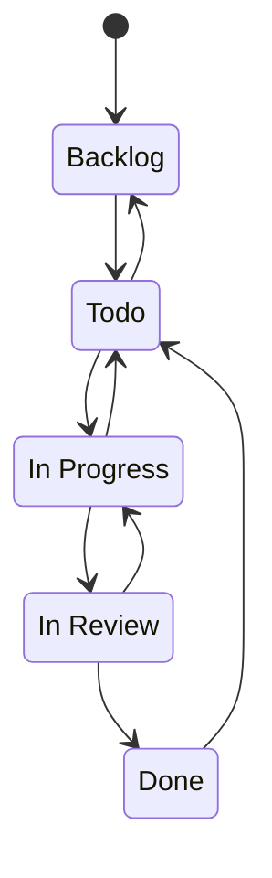

# Curved

A lightweight, self-hosted, agent-first issue tracker. Linear's workflow without
per-seat pricing, with the rules that matter enforced in code and in Postgres.

Agents coordinate through prompts, and prompts get violated: a second item starts
while the first is still in review, an illegal status move goes through, and
nobody can say who did what when. Curved moves those rules out of the prompt.

## What you get

- **A five-status workflow with legal edges only.** Backlog, Todo, In Progress,
  In Review, Done. One transition graph is validated in the service layer, so an
  illegal move returns a machine-readable error instead of a silent write.
- **One active issue per agent.** A partial unique index enforces it in Postgres,
  globally across projects, so a second claim fails with `agent_busy`.
- **An append-only timeline.** Every status change, claim, comment, label, and
  relation is an `issue_events` row. Nothing updates or deletes one.
- **An agent interface with no SQL.** MCP over stdio, the CLI, and the HTTP API
  share one service layer; agents claim, comment, submit for review, block, and
  release.
- **Per-project keys, allocated atomically.** Issues are `TAC-14`, never a global
  counter.
- **A human board.** A responsive SPA with five lanes, a ready queue, issue detail
  with the timeline, and a `Ctrl/Cmd+K` palette. Sign in with a passkey; the UI
  token is the fallback and how you add the first one.
- **Realtime updates.** One SSE stream carries `issues_changed` per project, so
  the board and an open issue refresh without polling.
- **Projects and their details.** Summary, description, six statuses, priority,
  dates, per-status progress, and archive. Sub-issues, per-project labels, and
  blocking relations round out the model.
- **GitHub automation.** A pull request that opens, reopens, or becomes ready
  moves its issue to In Review; a merge moves it to Done. `git-branch <KEY>`
  prints the canonical branch name.
- **Self-hosted end to end.** One image, a Compose stack with Caddy for TLS and
  unbuffered SSE, scripted backups and restore, and a one-command release that CI
  runs on every merge to `main`.

## The workflow

Five statuses and one directed graph. A separate actor matrix gates the edges:
humans take any legal move, an agent claims an unclaimed `todo` issue and may
then only move that issue to `in_review` or back to `todo`, and the webhook acts
as `git` with `in_progress` -> `in_review` and `in_review` -> `done`. Blocking is
a reason plus `todo`, not a sixth status. Every issue payload carries
`allowedTransitions`, the successors the requesting actor may take right now.



Full rules: [docs/workflow.md](docs/workflow.md).

## How it works

One Node 26 process over Postgres 18 serves the JSON API, the SPA, and the SSE
stream, plus the GitHub webhook. The tree is layered: `src/domain/` holds pure
rules, `src/application/` the SQL-free use cases and their ports,
`src/adapters/` the HTTP, MCP, CLI, Postgres, and static boundaries, and
`src/composition/` the entry points. Imports point inward, and `npm run check`
fails when one does not. [ARCH.md](ARCH.md) is the contract.

## Quick start

```sh
npm install
npm run db      # start Postgres and apply migrations
npm run build
export CURVED_UI_TOKEN=dev-secret
npm start
```

Open <http://127.0.0.1:4747>; the first run creates a project. Sign in with a
passkey (add it from the UI-token form) or with the token. For client work run
`npm run dev` beside `npm start`, which puts Vite on 5173 and proxies `/api` to
4747.

Checks: `npm test`, `npm run check`, `./scripts/init.sh`. The end-to-end gate is
`npm run acceptance`, documented in
[docs/development.md](docs/development.md).

## Deploy

The production stack lives in `deploy/`: Postgres, the app image, and Caddy for
TLS, the HTTP-to-HTTPS redirect, HSTS, compression, and unbuffered SSE.

```sh
cp deploy/.env.example deploy/.env
chmod 600 deploy/.env   # fill in the secrets
docker compose -f deploy/docker-compose.yml up -d --build
```

A push to `main` runs `verify` and deploys through `deploy/release.sh`. Host
provisioning, backups, releases, and rollback are in
[docs/operations.md](docs/operations.md) and
[deploy/provisioning.md](deploy/provisioning.md).

## Use it with agents

```sh
node src/composition/cli.ts ready
node src/composition/cli.ts claim
node src/composition/cli.ts review <KEY> "what changed"
```

The same loop is available over MCP over stdio and over the HTTP API:
[docs/clients.md](docs/clients.md), [docs/cli.md](docs/cli.md), and
[docs/api.md](docs/api.md). The skills in `skills/` install with
`npx skills add DietKyle956/Curved`.

## Documentation

| Document | What it covers |
| --- | --- |
| [docs/workflow.md](docs/workflow.md) | Statuses, the actor matrix, claims, blocking |
| [docs/cli.md](docs/cli.md) | Every CLI command and flag |
| [docs/api.md](docs/api.md) | HTTP auth, routes, errors, realtime, the GitHub webhook |
| [docs/clients.md](docs/clients.md) | The web client, the MCP server, and the agent skills |
| [docs/operations.md](docs/operations.md) | Image, Compose stack, host provisioning, backups, releases, CI |
| [docs/development.md](docs/development.md) | Local commands and the acceptance gate |
| [ARCH.md](ARCH.md) | Architecture contract and the dependency rule |
| [AGENTS.md](AGENTS.md) | Agent working agreement |
| [initial_idea.md](initial_idea.md) | Product intent |

## Status

Curved is live at <https://curv3d.duckdns.org> and runs this repository's own
issues. Current verified state and the next step are in [MEMORY.md](MEMORY.md).
